<h2 align="center"> Hello World! I'm José Joaquín Virtudes Castro</h2>

<b>Data Platform Engineer</b> — Awarded the Best Academic Record 🏅 | Apache Airflow | Kubernetes | Open Source Contributor

### 🏠 Homelab
- ☸️ Kubernetes cluster at home
- 🔁 GitOps with **Argo CD**
- 🐦 CI with **Woodpecker CI**
- 🔒 Exposed via **Cloudflare Tunnel**
- 🏡 **Home Assistant** automations

### 🔁 GitOps Flow

### 🛠️ Tech Stack

#### Data & Backend
    

#### Platform & GitOps
        

### 📈 Contributions

 

